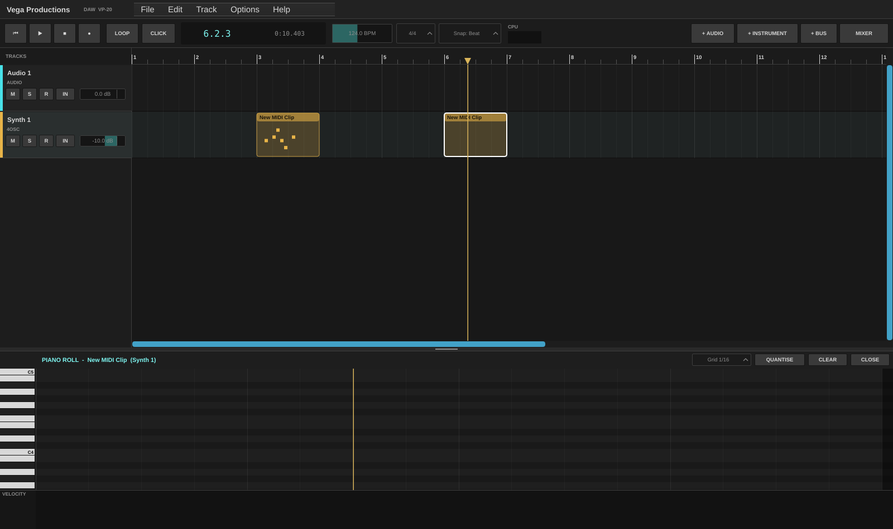
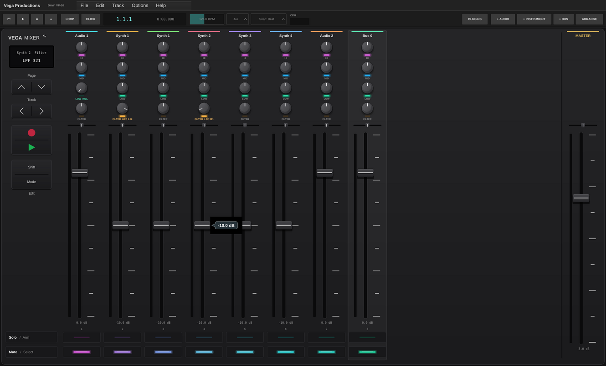

# Vega Productions DAW (VP-20)

A digital audio workstation for the Vega Productions suite — built on the open-source **Tracktion Engine** (the engine behind Waveform) and JUCE.




## Download
- **Windows:** https://github.com/DJVega70/vega-daw/releases/latest/download/VegaProductions-DAW-Windows.zip — unzip anywhere and run `Vega Productions DAW.exe`.
- **Mac:** https://github.com/DJVega70/vega-daw/releases/latest/download/VegaProductions-DAW-macOS.zip — drag the app to Applications, then run once in Terminal: `xattr -cr "/Applications/Vega Productions DAW.app"`

First run: **Options > Audio / MIDI settings** (pick ASIO / WASAPI on Windows, CoreAudio on Mac, and enable your MIDI keyboard), then open the **PLUGINS** panel (button at the top right, or press **B**). The DAW scans your standard VST3 folder (and AU on Mac) by itself on first launch and picks up newly installed plug-ins every time it starts. Use **FOLDERS** if you keep .vst3 files somewhere else.

**Mixer (Tab)**, styled after a Launch Control XL, with a DJ section on every channel:
- **HI / MID / LOW** (pink / blue / green) is a 3-band isolator EQ.
  - The crossovers are at 250 Hz and 2.5 kHz.
  - 12 o'clock is flat, the top of each knob is +6 dB, and turning a knob fully left **kills** that band.
  - The LED goes dark when a band is killed.
- **FILTER** (orange) is a one-knob DJ filter.
  - Turn it left for low-pass and right for high-pass. The centre is off.
  - The LED lights, and the readout shows the cutoff, while it's engaged.
  - Double-click any knob to reset it.
- **Pan** is the small slider under the knobs. Sends are in the channel's edit section (press **Mode**).
- **Master section**: a full console channel strip on the master bus, in the order input → filters → EQ → gate → compressor → output.
  - **Filters:** HP (16–500 Hz, 18 dB/oct) and LP (3–22 kHz).
  - **4-band EQ** with an **EQ** in/out switch:
    - **HF** (1.5–22 kHz, shelf or bell);
    - **HMF** (0.6–7 kHz, with Q);
    - **LMF** (0.2–2 kHz, with Q);
    - **LF** (40–600 Hz, shelf or bell).
  - **Compressor:** ratio 1:1 to ∞:1, threshold, release, fast attack, peak/RMS detection and automatic make-up gain.
  - **Gate / expander:** range, threshold, release, hold, expand and fast attack.
  - **Gain-reduction LEDs** for the compressor and the gate.
  - **Input and output trims**, big output meters with peak hold, a polarity switch and **CUT**.
  - **The master fader.**
  - Everything is saved with the project. Double-click a knob to reset it.
- **Each fader** has a scale and a level meter. Under the faders are two rows of lit pads: **Solo** and **Mute** (lit = playing).
- **The left column** is a console-style transport section:
  - a display showing the last control you touched;
  - **MARKER** drops a marker at the playhead, or removes one that's there. Shift + ◀◀ / ▶▶ jumps between markers.
  - **NUDGE** makes ◀◀ / ▶▶ move the selected clip by one grid step.
  - **CYCLE** is loop. **DROP** is punch-in/out recording inside the cycle range.
  - **REPLACE** makes MIDI recording replace notes instead of layering them.
  - **CLICK** is the metronome. **SOLO** solos the selected track.
  - **EDIT** shows or hides each channel's instrument, inserts and sends.
  - **◀◀ ▶▶ ■ ▶ ●**: rewind and fast-forward move one bar (hold them to keep going), then stop, play and record.
  - **FADER BANK ◀▶** moves 8 channels at a time; **CHANNEL ◀▶** moves 1.
  - **The arrow pad** selects tracks (up/down) and moves the playhead by a bar (left/right). The cyan centre key switches it to zoom.
  - **The jog wheel** moves the playhead. With **SCRUB** lit, it plays the audio as you turn it.
  - Click the line above the pads to toggle **Shift**, which turns the pads into **Arm / Select**.


## Download
- **Windows:** https://github.com/DJVega70/vega-daw/releases/latest/download/VegaProductions-DAW-Windows.zip — unzip anywhere and run `Vega Productions DAW.exe`.
- **Mac:** https://github.com/DJVega70/vega-daw/releases/latest/download/VegaProductions-DAW-macOS.zip — drag the app to Applications, then run once in Terminal: `xattr -cr "/Applications/Vega Productions DAW.app"`

First run: **Options > Audio / MIDI settings** (pick ASIO / WASAPI on Windows, CoreAudio on Mac, and enable your MIDI keyboard), then open the **PLUGINS** panel (button at the top right, or press **B**). The DAW scans your standard VST3 folder (and AU on Mac) by itself on first launch and picks up newly installed plug-ins every time it starts. Use **FOLDERS** if you keep .vst3 files somewhere else.

**Mixer (Tab)**, styled after a Launch Control XL:
- **Each channel** has:
  - three knob rows: Send A (pink), Send B (blue) and Pan (green), each with an LED that lights when the knob is in use;
  - a long-throw fader with a scale and a level meter;
  - two rows of lit pads: **Solo** (top) and **Mute** (bottom, lit = playing).
- **The left column** has:
  - a display showing the last control you touched;
  - **Page ▲▼** to move 8 channels at a time;
  - **Track ◀▶** to select the previous or next track;
  - **Record / Play**;
  - **Shift**, which turns the pads into **Arm / Select**;
  - **Mode**, which shows or hides each channel's instrument and insert section.


**AI stem separation**
- Right-click an audio clip and choose **Separate stems (AI)...**, or use **File → Separate stems from a song (AI)...**.
- Choose **4 stems** (Vocals, Drums, Bass, Other) or **6 stems** (also Guitar and Piano).
- Each stem lands on its own coloured track, lined up exactly with the original clip, and the original clip is muted. The WAV files go to a **Stems** folder next to the project.
- It uses Meta's Demucs v4 model, running locally on your CPU via [demucs.cpp](https://github.com/sevagh/demucs.cpp).
- The model (84 MB, or 55 MB for 6 stems) is downloaded once, the first time you use it.

**Stage 2**
- **Automation:** press **A** on a track to open its lane and pick any parameter (volume, pan, the DJ EQ, plug-in knobs). Click to add points, drag to move them, and double-click or right-click to delete. Turn on **WRITE** in the transport, then press play and move a fader to record automation.
- **MIDI learn:** press **LEARN**, move a control on screen, then move a knob on your controller. **Options → MIDI learn mappings** lists and removes them. Mappings are saved with the project.
- **Mackie Control (MCU):** **Options → Mackie Control** sets up an X-Touch, iCON, QCon, FaderPort or similar surface in MCU mode. Its faders, V-pots, transport, banking and display follow the mixer.
- **Elastic audio (warp markers):** right-click an audio clip and turn on elastic audio. Ctrl/Cmd-click inside the clip to add a marker, drag a marker to stretch the audio around it, and double-click one to remove it.
- **Freeze:** right-click a track header and choose Freeze to render its instrument and plug-ins to audio and save CPU.

**Stage 3**
- **Routing matrix (Track → Routing matrix...):**
  - Every track and bus is listed down the side.
  - **OUTPUT** columns route each track to the Master or to a bus.
  - **SENDS** columns add or remove sends to each bus (−6 dB to start); drag up or down on a send to change its level.

**Using plug-ins**
- **Load:** in the PLUGINS panel, double-click a plug-in or drag it onto a track or mixer strip. Its window opens right away. An instrument goes on the selected instrument track, or on a new one. An effect goes on the selected track.
- **Reopen:** every track header has an **INST** button that opens its instrument and an **FX** button that lists every plug-in on the track; click one to open it. In the mixer, click the instrument name or an insert slot.
- **Window position:** plug-in windows stay on top of the DAW, so they never get lost behind it.

## Stage 1 features
**Audio engine** — 32-bit floating-point processing, multi-core graph, plugin delay compensation (Tracktion Engine). ASIO (when available at build time), WASAPI and DirectSound on Windows; CoreAudio on Mac.

**Arrange**
- Audio, instrument and bus tracks; record audio and MIDI (arm **R**, choose inputs with **IN**, input monitoring), loop recording, metronome.
- Non-destructive clips: move (also between tracks), trim either edge, fade in/out handles, split at playhead, duplicate (Alt-drag or Ctrl+D), mute, rename, clip gain, reverse, loop.
- Audio clips: **Warp to project tempo** (time-stretch) and **pitch shift** ±12 semitones, **slice at transients**.
- Drag audio (WAV/AIFF/FLAC/OGG/MP3) or MIDI files straight onto the timeline.
- Snap to bar / beat / 1/8 / 1/16, zoom (Ctrl+wheel), loop range on the ruler, tempo and time signature, undo/redo.

**Piano roll** — add / move / resize / delete notes, velocity lane, grid incl. triplets, quantise, note audition.

**Mixer** — channel strips with inserts (VST3/AU or built-ins: EQ, compressor, reverb, delay, chorus, phaser, filter, pitch shift), plugin bypass/re-order, **aux sends** to buses, **output routing** of tracks into buses, **sidechain inputs** for plugins that support them, pan, fader, meters, mute/solo, master.

**Instruments** — every instrument track can host any VST3/AU synth (Vega Multisynth, Workstation, Drums, Sampler, Chords…) or the built-in 4-Osc synth / sampler. Your MIDI keyboard plays whichever instrument track is selected.

**Files** — projects saved as `.vegaproj`; export the mixdown (or just the loop range) to 24-bit WAV.

## Controllers: Novation FLkey 2 (and other HUI surfaces)
The DAW has a built-in **HUI controller script**, the protocol the FLkey 2 uses for DAWs other than FL Studio.

1. Plug in the FLkey 2 49 and start the DAW. It connects automatically to the keyboard's **DAW port**
   (`MIDIIN2 / MIDIOUT2 (FLkey 2 49)` on Windows, `FLkey 2 49 DAW Out / DAW In` on Mac).
   Check **Options > Controllers (FLkey 2 / HUI)** — it says CONNECTED, and every button/fader you touch appears in the MIDI monitor.
2. The keys, wheels and drum pads (in Drum mode) use the normal **FLkey 2 49 MIDI** port and play whichever instrument track is selected —
   pads send General-MIDI drum notes, so they play Vega Productions Drums directly.

| FLkey 2 control | Vega Productions DAW |
|---|---|
| Faders 1–8 | Volume of 8 tracks (motorless faders jump to the value) |
| Fader buttons | Select track (MIDI keyboard follows the selection) |
| Encoders | Pan — or Send A–E level in Sends mode (turning up a send creates it to that bus) |
| Pads (DAW mode) | Mute / Solo |
| Bank / Channel ◀ ▶ | Move the 8-track window / one track |
| Play, Stop, Record, Loop | Transport (Stop when stopped = return to start) |
| Track/cursor buttons | Previous / next track, playhead by a beat |

Feedback goes back to the controller: fader values, mute/solo/select/arm lights, encoder positions, 4-letter track names and transport lights.

## Roadmap
- **Stage 2:** ✅ HUI / FLkey 2 controller script. Next: automation lanes, MIDI-learn, Mackie Control (MCU), warp markers, track freeze.
- **Stage 3:** Ableton Push / controller scripts, routing matrix view, comping, video.

AAX is not supported: Avid only allows AAX plugins inside Pro Tools.

## Building
```
git clone https://github.com/Tracktion/tracktion_engine.git te   # see TE_COMMIT in the workflow
git -C te submodule update --init modules/juce
cmake -B build -DTE_DIR=$PWD/te -DVEGA_TESTS=ON
cmake --build build --config Release --target VegaDAW VegaDAWTest
```

## License
GPLv3 (see `LICENSE`), because Tracktion Engine is used under its GPLv3 license (`TRACKTION_LICENSE.md`). Free for your own use; selling it would need a commercial Tracktion Engine license.
